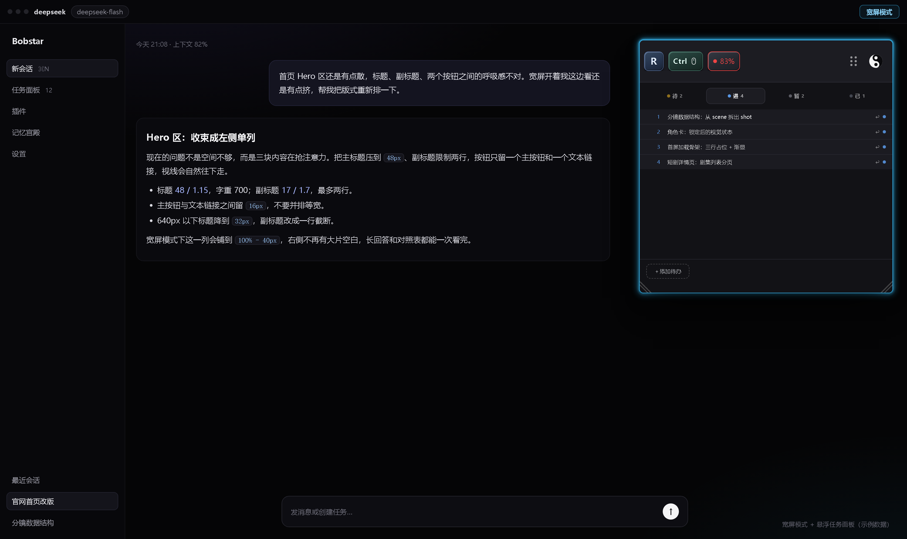
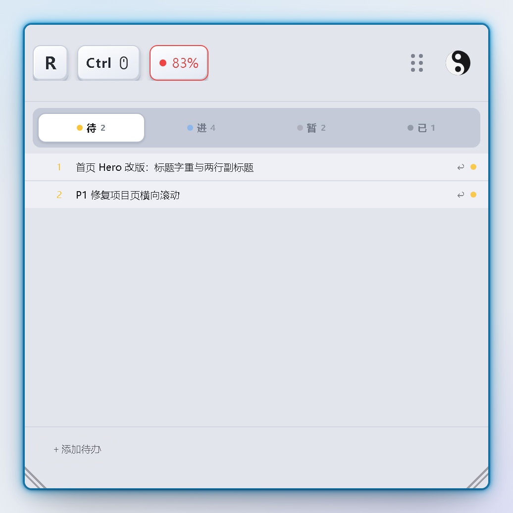
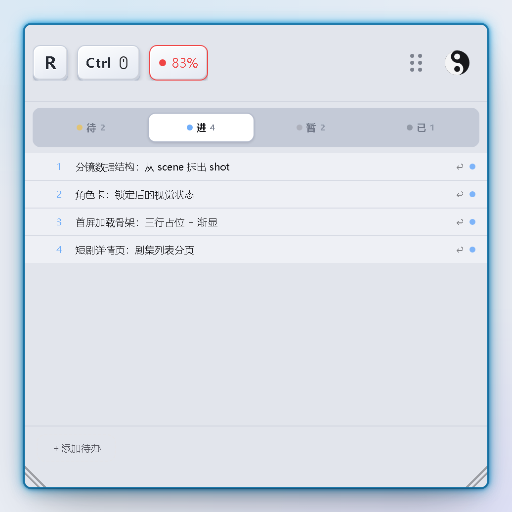
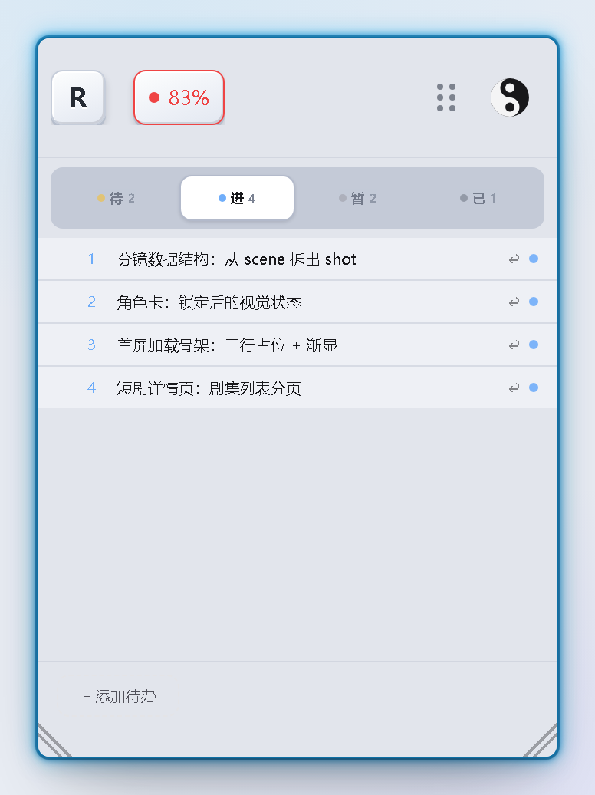
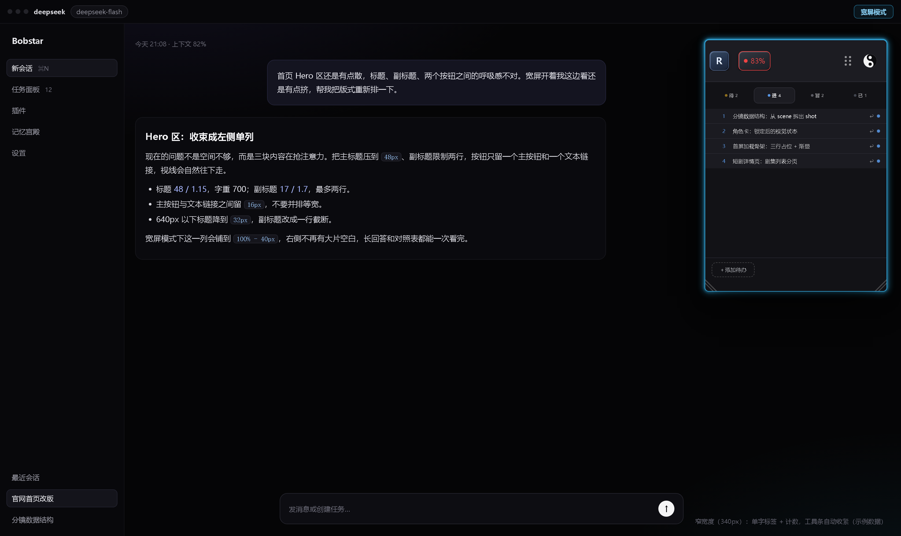
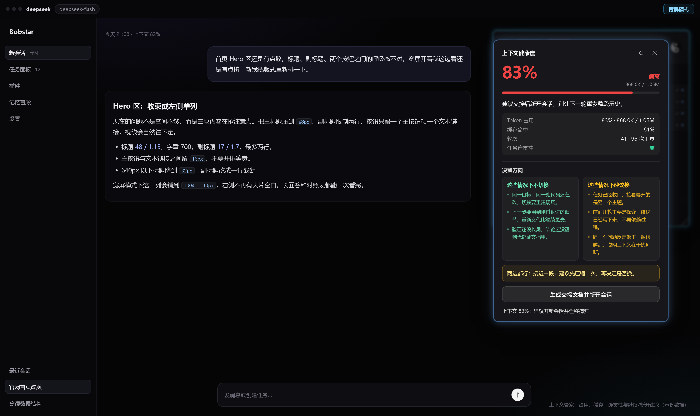

# dsh-wide-focus · 宽屏 + 悬浮任务面板 + 上下文管家

一个插件，给 DSH 桌面客户端补上三件事，全部在本机运行、零运行时依赖：

1. **宽屏阅读模式** —— 对话列铺到 `100% - 40px`，不再挤在窄窄的阅读宽度里，长回答、长表格和来回问答能一次看完。
2. **悬浮任务面板** —— 浮在对话上方的待办看板：随手拖动、折叠成胶囊、双角缩放，聊天把面板挤掉时按 `R` 就能召回来。
3. **上下文管家** —— 面板工具条上的占用徽章；点开是实时的上下文占用、缓存命中、任务连贯性和「继续 vs 新开」建议，一键生成交接文档并新开会话。

> 从 v0.12.0 起，原来的 `dsh-context-guard` 已合并进本插件（徽章、上下文卡片、`/context-guard/*` 路由都在这里），不需要再单独安装。



## 安装

```powershell
# 1) 从 GitHub（公开仓库，固定 tag）
dsh plugin --profile desktop add git+https://github.com/quanwenbo/dsh-wide-focus.git#v0.12.3

# 2) 从本地目录（开发时）
dsh plugin --profile desktop add C:\Users\BOB\dsh-plugins\wide-focus
```

- 如果之前装过 `dsh-context-guard`，先卸掉，避免出现两个徽章：
  `dsh plugin --profile desktop remove dsh-context-guard`
- 客户端半边（`client.js`）刷新页面即生效；宿主半边（`index.js`）注册了
  `/wide-focus/tasks`、`/context-guard/state`、`/context-guard/handoff`，
  首次安装或改过 `index.js` 后需要重启一次桌面端。
- `client.js` 是预构建 ESM，`index.js` 是普通 ESM，`cordis.patch.yml` 在包根目录，
  所以从 git 或 tgz 安装都不需要构建步骤。

## 宽屏阅读模式

- 打开后给 `<html>` 加 `data-dsh-wide-focus`，把 `--dsh-chat-user-width`
  覆盖成 `calc(100% - 40px) !important`。
- 宿主每次 resize 都会重写节点上的内联 `--dsh-conversation-column-width`，
  所以插件在开启期间每 400ms 同步一次这些节点。
- `[data-width-handle]` 会隐藏：这一列不靠拖拽调宽，用按钮切换宽屏/标准即可。
- 开关在会话标题栏的 **宽屏 / 标准** 按钮
  （`conversation.session.header.utilities`，id `wide-focus-toggle`，order 30）。
  默认开启，选择记在 `dsh.wide-focus.enabled`。

## 悬浮任务面板

- 挂载在 `shell.overlay`，id `wide-focus-task-panel`，order 60。
- 标题栏是一条 78px 高的拖动条，从左到右依次是：
  `R` 键帽、`Ctrl`+滚轮键帽（含滚轮图标）、上下文管家徽章、六点抓手、八卦主题按钮。
- 拖标题栏即可移动，面板被夹在视口内；点标题栏折叠成胶囊，再点胶囊或按 `R`
  展开；双击标题栏恢复默认尺寸与位置。
- 从底部两个角缩放，最小宽度 300px。
- 字号：在面板上 `Ctrl` + 滚轮，或 `Ctrl` + `=` / `Ctrl` + `-`；界面上没有 +/− 按钮。

### 标签页

四个标签，固定顺序：**待验收 / 进行中 / 暂时搁置 / 已验收**。

- 同时只渲染一个标签；标签条固定在列表上方，不随列表滚动。
- 每个标签显示状态圆点、名称和该分类的任务数。
- 换分类有两种方式：展开任务后点状态按钮（完成 / 进行中 / 暂时搁置 / 撤销验收），
  或抓住行首的 `≡` 把手拖到目标标签上。落下后面板仍停在原标签，
  目标标签会轻轻弹一下、计数发光两秒，提示「东西进去了」。
- 拖拽有完整反馈：被拖的行变暗、标题副本跟着指针、悬停的标签或插入位高亮；
  松手后目标行闪一下、标签弹一下，底部出现「已移到「…」」小胶囊。
- 指针悬停在某个标签上时，拖影会收缩到该标签宽度的 80% 并贴上去；
  在那里松手会播一段穿越闪光，表示任务落进这个分类。
- 松手时拖影先缩进落点（180ms）再消失，读起来像「放进去」而不是「凭空消失」。
- 鼠标下按下并移动就开始拖（触屏仍保留 260ms 长按，避免影响滚动）；
  同一标签内可自由排序，松手后编号按 1..n 重排。
- 在同标签里拖动时，插入位置会展开一条虚线「放到这里」，列表让位，
  松手前就能看清落点；命中判断用几何位置，落在两行之间也对得上。
- 拖到 **已验收** 等于通过验收，把任务拖出已验收等于撤销验收。
- 当前标签记在 `dsh.wide-focus.activeTab`；空标签显示「这个分类暂时没有任务。」，
  标签条不会自己收起。

### 任务行

- 第一行是标题，其余内容（右键收集的选中文字，或手动输入的描述）作为正文，
  保留原来的段落与行内格式（安全 HTML：p、strong、em、code、pre、列表、引用、链接、br）。
- 点正文即可就地编辑（textarea，默认 2 行，最高 360px）；正文为空时是一块可点击的留白，
  没有占位文案。
- 在对话里选中任意文字 → 右键「加入待办」，选中内容成为一条任务，首行作标题。
- 「＋ 添加待办」是列表第一行，输入后按 `Enter` 添加（多行输入，`Shift` + `Enter` 换行）。
- 添加成功后会自动展开面板、跳到「进行中」、滚到新行，并弹一条「已添加：…」；
  重复内容不重复添加。

### 拖拽细节

- 拖拽反馈都在面板内部完成：拖影是面板里的绝对定位副本，用 `requestAnimationFrame` 合并更新；
  行、标签、落点的强调分别用 950ms / 700ms / 即时高亮。
- 拖动过程中目标是标签时，标签本身高亮；目标是行时，插入槽高亮。
- 松手位置落在当前标签本身不会切换标签，只做排序。

### 主题

面板自带配色，不跟随宿主主题。

- 标题栏最右侧是一枚 45×36 的八卦按钮（六点抓手右边）：无边框、无底色，悬停才出现浅底，
  圆角透明；圆盘由亮面、暗半和两个反向「种子」组成。点击在深/浅之间切换，
  圆盘旋转 180° 作为反馈，选择记在 `dsh.wide-focus.panelTheme`。
- 深色：外壳 `#17171b` → 标题带 `#0b0b0e` → 正文 `#1c2f4f`；
  浅色：外壳与标题带为浅灰白、任务行白底深字、分隔线更淡，强调色仍是那四个状态色。
- 状态色：暂时搁置 `#9a9aa5`、进行中 `#60a5fa`、待验收 `#fbbf24`、已验收 `#6b7280`。

浅色面板（只截面板本身，示例数据）：







## 窄宽度响应式

面板按自身宽度换布局，而不是把文字挤成省略号：

| 面板宽度 | 布局 |
| --- | --- |
| ≥ 480px | 完整标签名 + 计数 |
| 360–479px | 单字标签（待 / 进 / 暂 / 已）+ 计数，悬停显示全名 |
| < 360px | 同上，并隐藏 `Ctrl` 键帽提示（只留 `R` 与上下文徽章） |



- 最小缩放宽度 300px，拖拽手柄到此为止。
- 标签、计数、任务标题都不换行；长标题用省略号截断，展开后看完整正文。
- 拖动提示是主题按钮旁的六点抓手（整条标题栏仍可拖，点击仍折叠）。

## 上下文管家

- **徽章** —— 工具条上的 `NN%` 占用徽章（通过 `window.__dshWideFocus` 桥注册，id `context-guard`）。
  颜色五级：绿 → 琥珀 → 橙 → 红 → 红色脉冲（`ok / warn / hot / danger / alarm`，
  水位 60 / 70 / 80 / 85%）。
- **卡片** —— 点徽章打开：大号占用百分比、状态词、token 行、进度条、一句建议，
  四项指标（Token 占用、缓存命中、轮次与工具调用、任务连贯性），
  「继续本会话 / 新开会话」两栏权衡，推荐结论，以及唯一按钮「生成交接文档并新开会话」。
  卡片以任务面板为锚浮动，打开时给面板加磨砂玻璃效果。
- **阈值** —— 60% 只变色；70 / 80 / 85% 各提醒一次；80% 自动打开卡片，
  但每个会话只自动打开一次（手动关掉后不再弹）。
- **宿主路由** —— `GET /context-guard/state?sessionId=`、`POST /context-guard/handoff`；
  交接文档写到 `<cwd>/docs/handoff/YYYYMMDD-HHmm-<id>.md`，五节：
  我们在做什么 / 最近改了什么 / 当前状态 / 关键决策与约束 / 下一步。
- 占用优先取 DSH 自己的 `contextPressure` 投影（与 `contextOccupancy()` 一致），
  其次 provider usage，再次 `tokenMeter`；三者都没有时才退回按消息长度估算（显示 `≈`）。



## 推理档位（自动）

工具条上的小胶囊显示本次请求的推理档位，点开可以三选一：

| 模式 | 行为 |
| --- | --- |
| 自动（默认） | 每次发请求前按本轮提问改写 `reasoningEffort`，覆盖当前会话配置 |
| 只建议 | 不改配置，只在面板里显示「建议 Low / High …」和原因 |
| 固定 | 永远使用你选的档位 |

档位与 DSH 的枚举一一对应，只有 **Off / Low / High / Max** 四档，不额外发明名字：

- 短确认、「继续」这类指令 → **Low**
- 实现、修改、修复、单点排查 → **High**
- 带代码块、跨文件、定位报错、写方案 → **High**
- 「彻底 / 深入 / 全部改 / 一次性」这类大范围需求 → **Max**
- **Off 不会被自动选中**，只能自己手动选

实现走宿主 `agent/request` 瀑布：`await next()` 拿到本次调用的冻结配置后，替换其中的
`reasoningEffort` 再返回。若检测到你手动改过档位（当前档位不等于插件上次写入的值），
插件会让位、不覆盖。模式与固定档位存 `$DSH_PROFILE_DIR/wide-focus/effort.json`，
宿主路由 `GET / POST /wide-focus/effort`。

## 存储

- 任务只有一份：`$DSH_PROFILE_DIR/wide-focus/tasks.json`
  （回退 `$DSH_HOME/...`，再回退 `~/.dsh/wide-focus/tasks.json`）。
- 宿主提供 `GET /wide-focus/tasks` 与 `PUT /wide-focus/tasks`（原子写：先 `tmp` 再 rename）。
  客户端不再保留 IndexedDB 或 localStorage 任务副本；启动时拉取，改动 400ms 防抖保存，
  `pagehide` / `beforeunload` 时用 `sendBeacon` 兜底。
- 连不上宿主时面板里会出现一条「…」提示，点一下重试。
- 界面偏好仍在 localStorage：`enabled`、`activeTab`、`panelCollapsed`、`panelPos`、
  `panelSize`、`fontSize`、`panelTheme`。

## 扩展点

其它桌面插件可以把自己的小控件挂到面板工具条：

```js
const bridge = window.__dshWideFocus
if (bridge) {
  const dispose = bridge.registerTool('my-plugin', MyChip) // 返回注销函数
  bridge.hasTool('my-plugin') // 注册成功后为 true
  bridge.getSessionId() // 当前会话 id，或 null
  bridge.onSessionChange((id) => {}) // 返回取消订阅函数
  bridge.toolCount()
}
```

桥会等宿主插件几秒；超时后注册的控件会退回会话标题栏，等徽章挂上面板后自动移除。

## 本地校验

```powershell
node --check client.js
node render.mjs       # 用假 React 渲染真实组件
node smoke.mjs        # 槽位 / effect 注册
node --test tests.mjs # 纯函数（splitTaskText、moveTaskInList 等）
```

`render.mjs` 还会在 `navigator.language` 为 `zh-*` 时检查界面是中文，并确认四个标签名都在。

## 已知限制

- 开启宽屏时每 400ms 重新断言一次列宽；没有接入宿主的 ResizeObserver。
- 响应式分档按面板宽度判断（< 480px 收标签名，< 360px 隐藏 Ctrl 提示），不是容器查询。
- 拖拽基于 Pointer Events，需要鼠标或触控笔；没有键盘重排。
- 删除任务是两步确认，没有撤销。
- 任务编号就是当前标签里的可见顺序（1..n），每次增删、拖拽、验收都会重排。

## License

MIT © 2026 BOB
